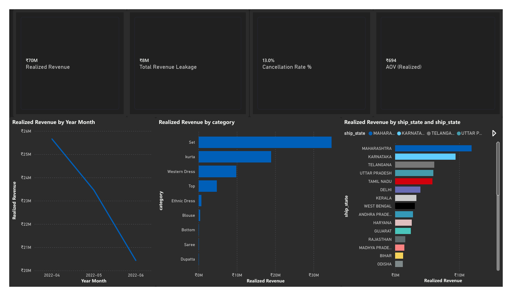

# E-commerce sales analysis

**Question.** What drove the April–June 2022 revenue decline, and where should the business focus first?

This is a portfolio analysis of an Amazon India sales export. I used MySQL for data cleaning and Power BI for the analysis, model, measures, and two-page dashboard. The source report describes 131,146 raw rows and 127,200 rows after cleaning. Its figures are project findings, not realized improvements to the business.

## Findings

- The stakeholder report records **₹69.6M realized revenue**, declining from ₹25.7M in April to ₹20.4M in June.
- **₹8.3M potential order value** was associated with cancellations and returns. This is neither recovered revenue nor net profit.
- The **Set** category accounted for about 81% of the measured revenue decline. Western Dress grew over the period and was a possible area to investigate for expansion.
- No cost data was available, so this project does not estimate profit.

## Evidence and files

| File | Purpose |
| --- | --- |
| [dashboard.pbix](dashboard.pbix) | Power BI Desktop project supplied with the portfolio. |
| [dashboard-overview.png](dashboard-overview.png) | Export of the overview report page. |
| [dashboard-set-filter.png](dashboard-set-filter.png) | Export of page 2 **with Set selected**. |
| [stakeholder-report.pdf](stakeholder-report.pdf) | Original five-page project report and definitions. |
| [sql/cleaning-review.sql](sql/cleaning-review.sql) | Curated, read-only SQL checks based on the saved MySQL cleaning notes. |
| [data-dictionary.md](data-dictionary.md) | Key source fields and interpretation. |

The [raw dataset ZIP](https://nour2303.github.io/assets/docs/Amazon_Sales_Raw_Data.zip) is hosted with my portfolio. It contains the original semicolon-delimited CSV. The source data is not included again in this repository.

## Reproduce or review

1. Download the raw ZIP and inspect its CSV headers and source terms before reuse.
2. Import the CSV into MySQL 8 with `;` as the delimiter. The saved SQL file documents checks and transformations from my exploratory work; it is **not** a one-click rebuild of the PBIX model.
3. Open `dashboard.pbix` in Power BI Desktop and review the two pages. Clear slicer selections when comparing overall numbers; the second screenshot shows a Set filter.
4. Compare dashboard results to the definitions in `stakeholder-report.pdf`.

## Limits

The raw cleaning notes included exploratory statements and unresolved assumptions, so I have published a conservative review script instead of presenting them as a fully tested pipeline. The report describes a 17-measure model, but this repository does not claim an independently repeated row-by-row SQL-to-Power BI reconciliation. Cancellation and return value represents *potential* order value, not a proven recoverable amount.
